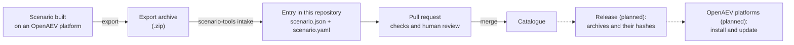

# OpenAEV scenarios

A catalogue of shareable attack scenarios for
[OpenAEV](https://github.com/OpenAEV-Platform/openaev), and the tools that prepare and check them.

> **Status: early.** The catalogue holds two scenarios:
> [EASM Scenario](scenarios/techniques/easm/), the first of the three scenarios of the platform's
> starter pack, and
> [Linux discovery then local account creation](scenarios/techniques/linux-discovery-local-account/),
> its first scenario in chaining. Releases, and installing a scenario from the catalogue straight
> into a platform, come later.

## What this repository is for

**OpenAEV** is an open-source platform for adversarial exposure validation. It plays realistic
attacks against your own systems, in a controlled way, to check that your defences see them and
stop them.

A **scenario** is the script of such an attack. It is a timeline of steps, called *injects*. An
inject can run a scan against a host, execute a command on a machine, or send an email to a team.
Each inject says what to do, against which target, and what a good defence should show: an alert,
a blocked command, a report from the team.

Anyone can build a scenario on their own platform. This repository is where scenarios are
**shared**. Each one is reviewed, described in the same way, and kept under version control. Any
OpenAEV user will be able to find it, understand what it does before running it, and get the next
version when it improves.

## How a scenario gets here



1. Someone builds and tests a scenario on an OpenAEV platform, then **exports** it as an archive.
2. The `intake` command turns the export into an **entry** of this repository. It replaces or
   removes what belongs to that one platform: internal identifiers, dates, users, the sender's
   address. It also writes a short description file next to it.
3. The entry is proposed in a **pull request**. Automated checks run `validate` and a secret scan
   on every entry it adds or changes, and the secret scan on every commit it brings. The tools,
   the rules and the workflow that run them are those of the branch the pull request targets, so
   that a pull request cannot change what judges it. Some rules of `validate` are not run yet. A
   human review then checks that the entry is complete, safe to publish, and does what it says.
4. Once merged, the scenario is part of the **catalogue**.
5. *Planned:* the catalogue is published in releases. Each archive comes with its hash (a
   fingerprint of the file), so that a platform can verify what it installs. OpenAEV platforms
   will then install a scenario from the catalogue and be told when a new version exists.

## What an entry looks like

Each scenario is a folder, filed by domain. This is the layout of an entry:

```text
scenarios/
└── techniques/            the domain: vulnerabilities, intrusion-sets, ransomware or techniques
    └── easm/              the entry's short name (its "slug")
        ├── scenario.yaml  the description: what it is, what it needs, which threat it plays
        └── scenario.json  the scenario itself, in a normalised form
```

- **`scenario.yaml`** is written for people and for the catalogue. It holds:
  - the name, a description and the severity;
  - the threat the scenario reproduces (MITRE ATT&CK techniques, CVEs, intrusion sets) and its
    sources;
  - the targets you must provide on your platform;
  - what your platform needs to run it: its version, its edition, and the injectors (the modules
    that run each step);
  - its **version**, and its **`external_id`**: an identifier (a UUID), chosen once, that never
    changes.
- **`scenario.json`** is the scenario as OpenAEV exports it, in a **normalised** form. Every value
  that only makes sense on one platform is replaced or removed, and lists whose order does not
  matter are sorted. Normalising the same export again gives the same file, so a change in this
  file is always a real change of the scenario.

The rules for both files are in [`schemas/`](schemas/). The data the checks use is in
[`policy/`](policy/): the domains, the platform's built-in injector contracts, the fields
removed from an export, the hosts and addresses a scenario may name, the actions it may never
take, and the commands that need a cleanup.

## The starter pack

OpenAEV installs three scenarios on each new platform, unless this is turned off: *EASM Scenario*
(external attack surface management), *Tabletop Exercise - Akira Ransomware Crisis* and *[SALT
TYPHOON] CVE & TTPs validation*. They are the catalogue's first entries, at version 1.0.0; EASM
Scenario is in, the two others follow.
Their identifiers are taken from the platform itself, and listed in
[`docs/starter-pack-ids.md`](docs/starter-pack-ids.md).

## The tools

The repository includes `scenario-tools`, a command-line tool written in Python.

| Command | What it does |
|---|---|
| `intake` | Turns a platform export and a short request into a new entry, or an update of one, with the version files of its new payloads, and writes the plan of the pull request; with `--check`, gives the verdict on each payload without git and writing nothing |
| `normalize` | Writes the normalised `scenario.json` of an export |
| `validate` | Checks entries against the schemas and the repository's rules (some rules are not run yet) |
| `render` | Writes the sheet of entries, their `README.md`, from `scenario.yaml` and `scenario.json`; with `--check`, reports a sheet out of date |
| `diff` | Lists what changed in entries since the base branch's copy, each change with the version it needs |
| `payloads` | Checks that `scenario.yaml` names each payload an entry embeds by a version of the catalogue, with its hash; with `--assign`, gives each payload its ID and version |
| `archive` | Builds the archive of an entry that the platform's importer reads |
| `validate-payloads` | Checks the payload catalogue, `payloads/`: its layout, each version file, and the rules across its versions ([`docs/payloads.md`](docs/payloads.md)) |
| `build` | Builds a release of the catalogue from a commit: every entry's archive, every payload version's file, and the manifest that lists them ([`docs/releases.md`](docs/releases.md)) |
| `approvals` | Collects who approved the last change of every entry, for `build` |
| `approve` | Names the release approver in a manifest `build` wrote, once the release is approved; the release job runs it |
| `verify` | Verifies a release as its consumers will: each archive and payload file against the manifest, safe extraction, the parts of its scenario, payload hashes ([`docs/consumers.md`](docs/consumers.md)) |
| `conformance build`, `conformance run` | Writes the release fixtures, or runs `verify` on them and compares what it gives with what they expect ([`conformance/`](conformance/README.md)) |
| `channel previous`, `channel pointer` | Checks that a channel's pointer names a release's manifest, or writes the pointer that moves the channel forward to an approved release; the release job runs them |
| `openaev export`, `openaev import`, `openaev check` | Exports a scenario from a platform, or imports an archive into one; `check` says, importing nothing, whether the platform holds another payload under an identifier the archive gives one ([`docs/consumers.md`](docs/consumers.md), check 9) |
| `check-title` | Checks a pull request title against the shared convention |
| `changed-entries` | Lists the entries a pull request adds, changes or removes, for the automated checks |

To run them, install [uv](https://docs.astral.sh/uv/), then, from a clone of this repository:

```sh
uv sync --frozen
uv run scenario-tools --help
uv run scenario-tools validate scenarios/techniques/easm
```

The `openaev` commands read the platform's address and an API token from the `OPENAEV_URL` and
`OPENAEV_TOKEN` environment variables. `openaev import` runs the check of `openaev check` first,
and imports nothing when it finds a payload the platform would run instead of the one released. Until scenarios can be installed from the
catalogue, `archive` then `openaev import` is the way to try an entry on your own platform.

The tools run on Linux, with git 2.40 or later; macOS is not tested yet. They read every file with
strict limits on size and depth, and never follow a symbolic link inside the repository. They
refuse invisible or direction-changing characters in the files they read, so that what a reviewer
reads is what the platform runs.

Every finding the tools report is explained, with what to do, in
[`docs/findings.md`](docs/findings.md).

These checks protect the review, not your systems. A scenario plays real attack techniques:
always read it before you run it, and only run it against systems you are allowed to test.

## Contributing a scenario

1. Build and test your scenario on an OpenAEV platform, then export it.
2. Follow [`docs/intake.md`](docs/intake.md): write a short request (identifier, domain, short
   name, threat, sources), run `intake`, and complete what its plan lists.
3. Run `validate` on your entry, then open a pull request with the title and body the plan gives.

An agent that proposes scenarios starts from [`AGENTS.md`](AGENTS.md).

A few rules apply to every pull request:

- **Public content only.** No customer data, no internal addresses, no real credentials. Targets
  are placeholders that each user fills in on their own platform. Reviewers check this.
- **Signed commits.**
- **A title** that follows [Conventional Commits](https://www.conventionalcommits.org/) and ends
  with the issue number, for example `feat(scenarios): add easm (#72)`.
- **A human review** of every change.

## Questions, security and licence

- **Questions and ideas:** open an issue in this repository. To take part, read
  [`CONTRIBUTING.md`](CONTRIBUTING.md) and the [code of conduct](CODE_OF_CONDUCT.md).
- **Security problems:** do not open a public issue. Report them privately, as
  [`SECURITY.md`](SECURITY.md) explains.
- **Licence:** the [Apache License 2.0](LICENSE), for the tools and the scenarios alike.

## Repository layout

| Folder | Content |
|---|---|
| [`scenarios/`](scenarios/) | The catalogue's entries, one folder each |
| [`payloads/`](payloads/) | The payload catalogue: one folder per payload, one frozen file per version ([`docs/payloads.md`](docs/payloads.md)) |
| [`schemas/`](schemas/) | JSON schemas of an entry's description, an intake request, a payload version file and a release manifest |
| [`policy/`](policy/) | The data the checks rely on |
| [`docs/`](docs/) | Guides: adding an entry, proposing one as an agent, the payload catalogue, the findings, releases and their consumers, security, the tools' architecture |
| [`src/`](src/) | The source of `scenario-tools`: how it is built, what it trusts and where to start reading, in [`docs/architecture.md`](docs/architecture.md) |
| [`tests/`](tests/) | Its tests, with real platform exports as reference data |
