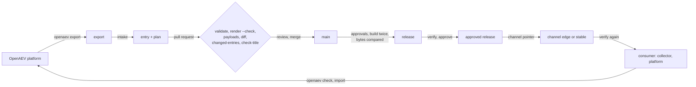

# Architecture of `scenario-tools`

For an engineer new to the repository: how the tools are built, what they trust, and where to
start reading. What each command does is in the [README](../README.md); what each finding means,
in [`findings.md`](findings.md).

## Layers

The tools follow a hexagonal layout, under `src/scenario_tools/`. Each layer imports only the
ones below it, and an adapter never calls a use case; `import-linter` (in `make check`) and
`tests/architecture/` keep it so.

| Layer | Holds | May use |
|---|---|---|
| `interface/` | The command line: options, which adapters a command wires into which use case, the report and its exit code | everything |
| `application/` | One use case per module: validate, intake, build, verify… | `domain/`, `ports/` |
| `ports/` | What a use case needs from outside: the repository's files, the schemas, the platform, an archive builder | `domain/` |
| `adapters/` | The ports implemented: files, git, ZIP, JSON and YAML readers, HTTP | `ports/`, `domain/` |
| `domain/` | The model and the rules, pure: no I/O, only the standard library and `rfc8785` | itself; `shared/` nothing else of the domain |

### The domain

| Package | Role |
|---|---|
| `shared/` | The shared kernel: findings, canonical JSON, the walk over a stored scenario's injects (`stored.py`), the workflow's keys and bounds (`workflow.py`) and its steps once checked (`stored_workflow.py`) |
| `catalogue/` | An entry of the catalogue: normalisation of an export (`normalisation.py`, with `export_reading.py`, `workflow_steps.py`, `volatile_fields.py`), stable identifiers (`identifiers.py`), metadata and its cross-checks (`metadata.py`, `facts.py`), intake's plan and payload verdicts (`intake.py`, `payload_verdict.py`) |
| `policy/` | What a public scenario may hold: one rule per module in `rules/`, run by `registry.py`; the rules of a workflow's graph and steps; the maintainers' data, read from `policy/data/` |
| `verification/` | What a consumer recomputes to trust content: payload hashes, payload references, versioning (`versioning.py`, `entry_changes.py`, `changelog.py`), a release's own output |
| `release/` | The manifest, the channel pointer, the pull requests an approval comes from |
| `sheet/` | The `README.md` of an entry, rendered from what it holds |

### The other layers

- `application/`: `validate_entry.py`, `intake_entry.py` (with `intake_check.py`,
  `intake_write.py`), `prepare_entry.py` (normalisation), `build_release.py`, `verify_release.py`,
  `build_fixtures.py` (with `fixture_parts.py`), and smaller use cases, one per command.
- `adapters/`: the readers every hostile input goes through (`safe_readers.py`, `safe_zip.py`), the
  repository (`repository.py`, `git.py`), the writer (`entry_writer.py`, `guarded_writes.py`,
  `places.py`, `plan.py`), the platform (`openaev_http.py`) and GitHub (`github_api.py`).
- `interface/`: `base.py` runs a command and maps what it raises to an exit code; one module per
  group of commands: `entries.py`, `intake.py`, `payloads.py`, `release.py`, `openaev.py`.

## Trust boundaries

Everything the tools read from outside is hostile until a reader has bounded it. A refusal is a
finding (`IO-*`, exit code 1) or, when the environment is at fault, exit code 3; exit code 4 is
kept for a defect of the tools.

| Input | Who controls it | Read by | Bounds |
|---|---|---|---|
| An entry's files in a pull request | A contributor | `adapters/repository.py`, then `safe_readers.py` | No link, parent directories included; YAML 256 KiB without anchors, aliases or tags beyond JSON's; JSON 20 MiB, 500,000 values, 64 levels, no duplicate key; text 1 MiB |
| A platform export (ZIP or JSON) | A contributor or a platform | `safe_zip.py`, `safe_readers.py`, then `catalogue/export_reading.py` | ZIP 20 MiB, 100 MiB decompressed, 1,000 entries, no link, no unsafe or renamed name; the export's keys from closed lists (`policy/data/export-keys.yaml`); JSON text inside a field decoded within the same bounds |
| A workflow | The same export | `shared/workflow.py`, `policy/workflow_rules.py`, `policy/step_rules.py` | 50 steps, 50 conditions per step, 16 levels; no step reading another's output into its inject |
| An intake request | A contributor | `interface/intake.py` | YAML, 64 KiB |
| A pull request's commits | A contributor | `adapters/git.py` | A full commit ID, never an option; no changed path with an empty, `.` or `..` component |
| A release (manifest, archives, pointer) | Whoever can publish, or a mirror | `application/verify_release.py`, `verification/release_output.py`, `safe_zip.py` | The manifest's schema and SHA-256 of each file; pointer 4 KiB; each archive as an export |
| The platform's answers | The platform | `adapters/openaev_http.py` | 1 MiB an answer, 4 MiB a contract, 16 MiB a page of payloads |
| GitHub's answers | GitHub | `adapters/github_api.py` | 4 MiB an answer |

Writes go through `entry_writer.py`: one directory at a time, held open, never through a link; what
a run cannot keep is taken back. Who could attack, and what stops them, is in
[`threat-model.md`](threat-model.md). The inputs that once got past these bounds are replayed by
the hostile corpus, `tests/hostile/`, on every run of the tools pipeline.

## From an export to a consumer

`intake` normalises the export (stable identifiers, no instance data), gives each embedded payload
its verdict against `payloads/`, writes the entry and the plan of its pull request. The checks of
a pull request run `validate` on each changed entry. A release is built from a commit, twice on
two runners, and the two builds must be the same bytes; `verify` checks it as a consumer will,
before the channel's pointer moves to it ([`releases.md`](releases.md),
[`consumers.md`](consumers.md)).

## What depends on an OpenAEV version

| What | Where | Changes when |
|---|---|---|
| The keys and versions of an export | `policy/data/export-keys.yaml` | The platform's exporter adds a key or a version |
| What changes from one export to the next | `policy/data/volatile-fields.yaml` | The exporter adds a volatile field |
| The built-in contracts and their facts, recorded on one version | `policy/data/builtin-contracts.yaml` (`platform_version`), finding `SCH-011` | The targeted version changes |
| The first release that imports a workflow's dependencies right | `CHAINING_OPENAEV` in `catalogue/metadata.py`, finding `SCH-015` | A fix of the import is released |
| The canonical hash of a payload, which the platform recomputes | `verification/payload_hash.py`, vectors in `conformance/payload-hash.json` | The platform changes its hash |
| The import archive's layout | `catalogue/archive.py`, `adapters/zip_archive.py` | The importer reads another layout |
| The platform's API | `adapters/openaev_http.py` | An endpoint the tools call changes |
| A scenario's own minimum | `requires.openaev` in each `scenario.yaml` | Set by the entry |

## Where to start reading

1. The [README](../README.md) and an entry under `scenarios/`: what the catalogue holds.
2. `domain/shared/finding.py` and `interface/base.py`: what every command reports, and how.
3. `adapters/safe_readers.py` and `adapters/safe_zip.py`: how a hostile input is read.
4. `application/validate_entry.py`, then `domain/policy/registry.py` and one rule of `rules/`.
5. `domain/catalogue/normalisation.py` and `application/intake_entry.py`: how an export becomes an
   entry.
6. `application/build_release.py` and `application/verify_release.py`, with
   [`releases.md`](releases.md).

`make check` runs everything CI runs; `make check-fast` is the quick loop. No function is beyond
complexity C and no module beyond 600 lines (`tests/architecture/test_size.py`).
